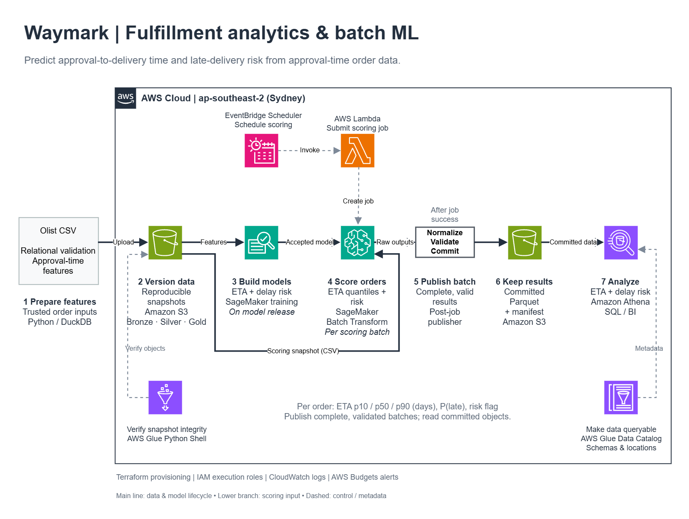

# Waymark

[](https://www.python.org/downloads/)
[](https://github.com/astral-sh/uv)
[](https://www.terraform.io/)
[](https://duckdb.org/)
[](https://github.com/astral-sh/ruff)

An end-to-end Data Engineering and Applied Machine Learning batch system for e-commerce order fulfillment.

At order approval time, Waymark transforms marketplace transactions into an analytical lakehouse (Medallion architecture on AWS S3), builds point-in-time features with strict temporal boundaries, prepares remote model evaluation and batch prediction code for SageMaker, EventBridge, Lambda, and Athena. Model training and scheduled end-to-end scoring have not been executed or accepted.

## Current status

Historical S3/Glue/Athena aggregate results are recorded in [`configs/c1_cloud_reconciliation.json`](configs/c1_cloud_reconciliation.json). The repaired snapshot/acceptance protocol is prepared locally and has not been applied or rerun on AWS. Local data, source and split artifacts are preserved. All learned-model fitting remains user-launched on managed SageMaker. Local tests use arithmetic, synthetic data and explicitly fake estimators only.

The project total cloud-spend cap is USD 30. The USD 8.50 pilot figure in the executable contract is a planning ceiling, not an observed bill. Budget notifications and query limits do not guarantee a hard spending cap.

---

## Architecture Overview



> Purpose: predict order delivery time and late-delivery risk, then publish complete, reproducible prediction batches for analysis. The horizontal framework distinguishes model release from recurring scoring and includes target integrations; it is not deployment evidence. Training and end-to-end scoring remain unexecuted. See the [purpose and handoff notes](docs/architecture.md), [deployment preparation](docs/operations.md#before-the-next-terraform-apply), [editable source](docs/images/waymark_aws_architecture.drawio), and [SVG](docs/images/waymark_aws_architecture.svg).

Local batch preparation now binds accepted model/input identities, provides prediction-only serving, finalizes successful JSONLines output into committed Parquet, and exposes only verified commits to readers. Publication is an explicit CLI operation; see the [batch delivery guide](docs/batch-delivery.md). Real model training, serving-image verification and scheduled end-to-end AWS acceptance remain separate work.

### Core Components

1. **Storage (Amazon S3 layered data lake)**:
   - **Bronze**: Raw immutable source snapshots in typed Parquet with SHA-256 source manifests.
   - **Silver**: Relational cleaning with foreign-key reconciliation and corrupt/unmapped record accounting.
   - **Gold**: Single-grain `fact_order_fulfillment` star schema and 34 point-in-time approval features.
2. **Metadata & Analytics (AWS Glue & Amazon Athena v3)**:
   - Serverless table registration via AWS Glue Data Catalog.
   - Interactive SQL analytics with hard 1 GB query scan limit guards to bound individual query scans; total usage still needs accounting.
3. **Machine Learning (Amazon SageMaker Spot Training)**:
   - **M1 (Delivery ETA)**: LightGBM Quantile Regressor (p10, p50, p90) with measured interval coverage and optional split-conformal adjustment.
   - **M2 (Delay Risk)**: CatBoost binary classifier with isotonic calibration and association-based TreeSHAP explanations.
   - Compute: `ml.m5.large` Managed Spot in `ap-southeast-2` (Sydney) with identity-bound completed-stage checkpoints; an interrupted fit restarts and its lost work is unknown.
4. **Batch Inference & Idempotent Orchestration**:
   - **Amazon EventBridge**: Daily schedule defined but disabled by default; future WM4 execution requires verified model/input artifacts.
   - **AWS Lambda Batch Adapter**: Submits Batch Transform requests and checks existing logical batches. A separate finalizer verifies JSONLines output, normalizes it to Parquet and conditionally commits an immutable object reference. Live end-to-end delivery remains unverified.

---

## Key Highlights

- **Approval-time Feature Engineering**: Declared cutoff at order approval timestamp (`order_approved_at`). Forbidden-column and delayed-outcome fixtures exercise the information boundary; rolling history uses mature prior outcomes. These checks do not prove universal leakage freedom.
- **Relational Integrity & Accounting**: Foreign-key and count-conservation guards cover multi-item and multi-seller joins. Observed historical population: 99,441 orders, from `configs/t4_gold_reconciliation.json`; current cloud replay is a separate check.
- **Cost-Frugal Cloud Architecture**: The contract selects Glue Python Shell (0.0625 DPU), Athena scan limits and bounded SageMaker jobs. Usage records separate observed allocation from estimates; unverified regional prices remain unpriced, and Spot savings are not applied twice.

---

## Repository Structure

```text
waymark/
├── configs/                          # Versioned contracts, fixtures, and manifests
│   ├── wm0_contract.yaml             # Single source of truth fulfillment contract
│   ├── t1_discriminating_fixture.json # Synthetic 8-order relational oracle
│   ├── t3_source_manifest.json       # SHA-256 source file hash inventory
│   ├── t4_gold_reconciliation.json   # DuckDB SQL parity metrics
│   └── t5_wm2_split_manifest.json    # 70-15-15 chronological split metadata
├── docs/
│   └── images/                       # Architecture diagrams (.png and .drawio)
├── infra/
│   └── terraform/                    # Infrastructure as Code (S3, Glue, Athena, Lambda, IAM)
│       ├── main.tf
│       ├── outputs.tf
│       ├── variables.tf
│       └── versions.tf
├── scripts/
│   ├── build_drawio_diagram.py       # Validate/render the canonical draw.io source
│   └── glue_etl_entry.py             # Serverless Glue Python Shell entrypoint
├── src/
│   └── waymark/                      # Core Python package
│       ├── batch_adapter.py          # Lambda handler for Batch Transform
│       ├── bronze_silver.py          # Medallion lakehouse ETL & accounting
│       ├── cli.py                    # Unified command line interface
│       ├── cloud_slice.py            # S3 sync, Athena queries, and verification
│       ├── contracts.py              # Schema models and invariant validators
│       ├── features_splits.py        # Point-in-time features and purged splits
│       ├── gold_model.py             # Star schema and DuckDB parity checks
│       ├── remote_requirements.txt   # Container dependencies for SageMaker
│       ├── sagemaker_entry.py        # SageMaker remote training script
│       └── training.py               # Managed Spot launcher & evaluation
├── tests/                            # Comprehensive unit and integration test suite
├── pyproject.toml                    # PEP 621 package metadata & dependencies
└── README.md
```

---

## Quick Start

### 1. Prerequisites

- Python `>=3.12, <3.13`
- [`uv`](https://github.com/astral-sh/uv) (fast Python package manager)
- AWS CLI configured with active credentials (optional for local pipelines, required for cloud stages)

### 2. Environment Setup

Clone the repository and install dependencies:

```bash
git clone https://github.com/tjunjie1408/Waymark.git
cd Waymark

# Install dependencies using uv
uv sync
```

### 3. Run Test Suite

Run unit and integration tests:

```bash
# Run all tests
uv run pytest

# Check code formatting and linting
uv run ruff check src tests scripts
```

---

## Command Line Interface (CLI)

Waymark provides a unified CLI to execute local pipelines and cloud operations:

```bash
# 1. Verify fulfillment contract and synthetic test oracle
uv run waymark verify-wm0

# Existing frozen outputs cannot be overwritten. Use NEW output directories and
# distinct --export-summary paths for a new reconstruction.
# 2. Build Bronze & Silver layers from raw sources with accounting
uv run waymark build-t3

# 3. Construct Gold analytical model and verify DuckDB SQL parity
uv run waymark build-t4

# 4. Generate 34 point-in-time features and chronological splits
uv run waymark build-t5

# 5. PREPARATION ONLY: create a local hash inventory without AWS calls
uv run waymark prepare-cloud-snapshot --output data/handoffs/cloud_snapshot.json

# Future separately authorized cloud run; configure the prepared script URI first
# (see docs/operations.md). This uploads and starts billable work.
uv run waymark run-c1 --profile waymark --region ap-southeast-2

# 6. Future user-launched SageMaker training; requires verified receipts.
# Default: development evaluation only. Add --allow-holdout only with explicit
# final-holdout authorization after the development protocol is frozen.
uv run waymark train-remote --profile waymark --region ap-southeast-2 \
  --cloud-receipt data/cloud_runs/SNAPSHOT_ID/JOB_RUN_ID.json \
  --environment-receipt data/handoffs/verified_environment.json
```

---

## Cloud Deployment (Terraform)

Prepared infrastructure targets `ap-southeast-2`. The following deployment steps are future operator actions, not part of the local repair verification. Read [operations and recovery](docs/operations.md) before any apply or paid execution:

```bash
cd infra/terraform

# Initialize Terraform providers
terraform init

# Validate configuration
terraform validate

# Follow docs/operations.md to plan and apply with the prepared script URI.
# Do not apply with an unset glue_snapshot_script_uri.
```

Declared AWS resources (new protections require a future apply):
- **S3 Bucket**: `waymark-lake-pilot-149270211548-ap-southeast-2` (server-side encryption, versioning, life-cycle policies).
- **Glue Data Catalog**: `waymark_pilot_db` base database; repaired C1 uses a snapshot-specific analytical database.
- **Amazon Athena**: Workgroup with a strict 1 GB data scan limit guard.
- **AWS Lambda**: Container/Zip handler managing daily SageMaker Batch Transform jobs.
- **Amazon EventBridge**: Daily Scheduler schedule, disabled by default.
- **AWS IAM**: Operator-managed execution roles; existing role permissions are preserved by user instruction.

---

## Methodology & Invariants

| Component | Invariant / Standard | Verification Mechanism |
| :--- | :--- | :--- |
| **Contract (WM0)** | Explicit schema, data types, and nullability contracts | Synthetic 8-order fixture oracle test (`test_wm0_contract.py`) |
| **Lakehouse (WM1)** | Explicit row/key/sum conservation, orphan rejection and source hash checks | Synthetic counterexamples, hash-bound cloud inventory and full key/feature parity |
| **Features (WM2)** | Strict point-in-time boundary at `order_approved_at` | Label maturity buffer check (`t5_wm2_split_manifest.json`) |
| **Models (WM3)** | M1 (Quantile LightGBM) + M2 (Calibrated CatBoost) | Shared baselines, saved predictions, pinball/PR-AUC/calibration/uncertainty; user acceptance required |
| **FinOps Guard** | USD 30 project budget; alerts do not enforce a hard cap | Dated regional rates, per-query minimums, raw usage and billing reconciliation |

---

## Data and licensing

The Olist dataset terms and source are recorded in `configs/wm0_contract.yaml`. Raw data stay outside Git; tests use synthetic fixtures. No repository code license is declared by this README.

The remote dependency set has one owner: `src/waymark/remote_requirements.txt`. Remote execution requires a no-fit installation/import receipt for an ECR image digest running Python 3.12; no mutable image tag is trusted automatically.
