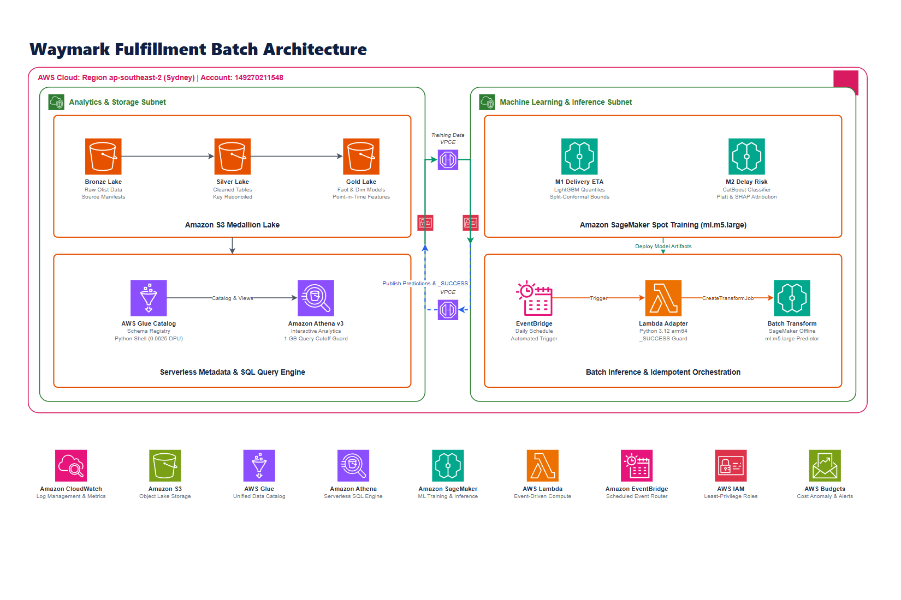

# Waymark workflow framework

The purpose is to predict approval-to-delivery time and late-delivery risk using only information available at order approval, then deliver complete, reproducible prediction batches for analysis. The numbered horizontal line is the target logical workflow. Supporting paths remain subordinate to it; execution status is recorded below the illustration.

| Stage | Why it exists | Input -> output | Handoff condition / owner |
| --- | --- | --- | --- |
| 1. Prepare features | Produce trustworthy order inputs without future-information leakage | Olist relational CSV -> reconciled tables and approval-time features | Local Python/DuckDB validates keys, grain and availability; labels are separate from inference predictors. No local fitting. |
| 2. Version data | Make the input reproducible across training, scoring and investigation | Prepared tables/features -> immutable S3 snapshot and inventory | Snapshot identity and object hashes are verified. Bronze/Silver/Gold are logical layers, not transformation services. |
| 3. Build models | Estimate delivery-time uncertainty and delay risk | Training snapshot -> evaluated M1 ETA / M2 risk models, preprocessing and schema | Remote training/evaluation prepares evidence; user acceptance precedes selection of a model package for scoring. This occurs on model release. |
| 4. Score orders | Generate predictions for the selected order batch | Existing accepted model plus scoring CSV -> raw per-order outputs | Scheduler/Lambda submits the declared batch. Scoring reuses its selected model and does not implicitly retrain. |
| 5. Publish batch | Prevent partial, malformed or mismatched results becoming consumable | Complete successful-job outputs -> normalized, validated Parquet and conditional commit | The post-job stage owns collection, normalization, exact-order coverage, value checks and publication. Failed or incomplete work must not create a visible new batch. |
| 6. Keep results | Retain traceable prediction batches | Validated data -> immutable prediction object plus commit manifest | The first successful logical-batch commit is retained. The two S3 icons describe different roles within the project lake bucket. |
| 7. Analyze | Make order ETA and risk available to SQL/BI | Committed manifest and its exact object -> queryable predictions | A manifest-aware reader selects only committed data. Catalog provides schema/location metadata, not batch-completeness enforcement. |

Business outputs are ETA p10/p50/p90 in days, probability of late delivery, and the frozen-policy alert flag for each order. They are predictions and risk indicators, not established causal effects or realized business benefits.

`Accepted model` is an artifact dependency through S3 and a compatible SageMaker model binding. It is not an instruction to retrain on every scheduled batch. The lower branch supplies the separate scoring snapshot. The `Raw outputs` arrow represents intermediate S3 objects; `After job success` is a publication prerequisite, not an assertion that the submission Lambda waits for completion. `Committed data` requires resolving the manifest's exact object rather than scanning every candidate under a prefix.

The lower-left Glue Python Shell component verifies snapshot inventory and object hashes in the repaired protocol. It does not perform the local Bronze/Silver/Gold transformations. The local C1 runner orchestrates upload, table registration and reconciliation; these supporting calls are omitted from the main line for readability. Athena result objects also reside in S3 and are omitted from this overview. The [batch implementation guide](batch-delivery.md) defines the local preparation, serving, explicit completion and committed-only consumption interfaces.

## Scope and status

Historical S3, Glue Catalog and Athena receipts remain in `configs/c1_cloud_reconciliation.json`. The repaired infrastructure and C1 v2 replay subsequently passed: the immutable snapshot, Catalog keys and complete model-input rows reconciled with local data. The real training image is prepared in ECR with a verified no-fit Toolkit bootstrap; model fitting is pending quota approval and a separate user order. Local batch code prepares identity-bound model/input descriptors, prediction-only serving, JSONLines normalization, successful-job finalization and committed-object reading/table registration. Those batch interfaces are locally tested; real accepted models, a verified serving image and scheduled end-to-end scoring remain unexecuted. Completion is an explicit Python 3.12 CLI operation; an automatic post-job trigger is not deployed. The schedule remains disabled. These qualifications stay in documentation rather than as badges in the workflow drawing. See [deployment status](operations.md#before-the-next-terraform-apply).

Current Terraform declares no VPC, subnet, security group or VPC endpoint. The diagram therefore uses an AWS Cloud boundary without invented network isolation. The footer names cross-cutting dependencies; it does not assert least-privilege IAM or a hard spending cap.

## Diagram artifact

Only the PNG architecture diagram is published in this repository. Authoring source and tools remain local.

Visual reference: [AWS architecture icons and diagramming resources](https://aws.amazon.com/architecture/icons/). AWS4 library icons retain service colors; the canvas and boundary remain neutral. Connectors are orthogonal. The main line shows data and model lifecycle dependencies; dashed lines show control and metadata dependencies.

Flow evidence: `src/waymark/{bronze_silver,gold_model,features_splits,cloud_slice,snapshots,training,batch_adapter}.py`, `scripts/glue_etl_entry.py`, `infra/terraform/main.tf`, and `docs/operations.md`.
